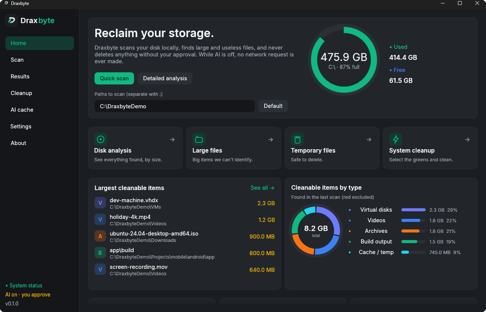
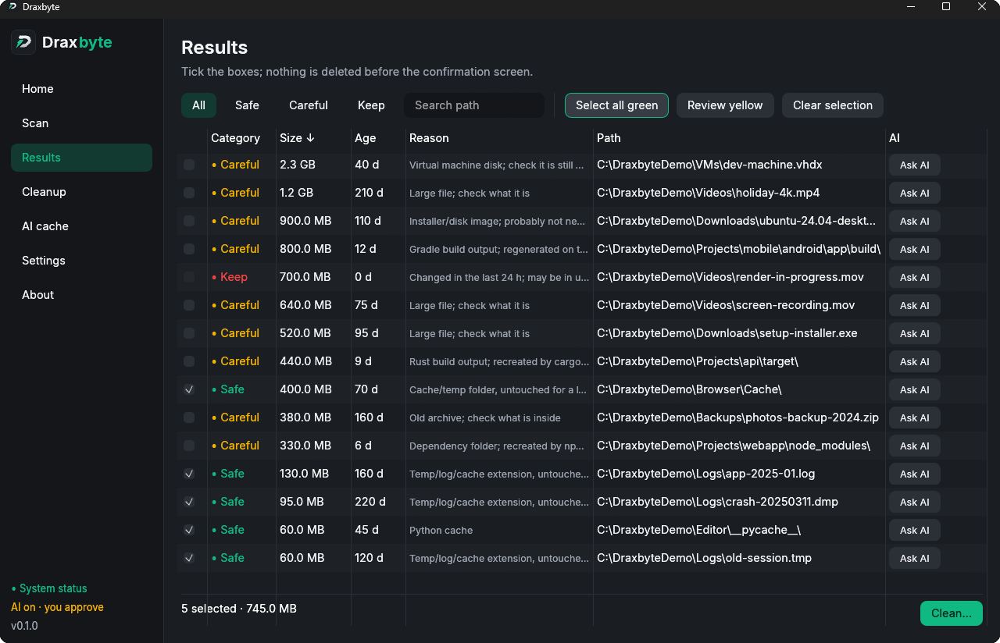
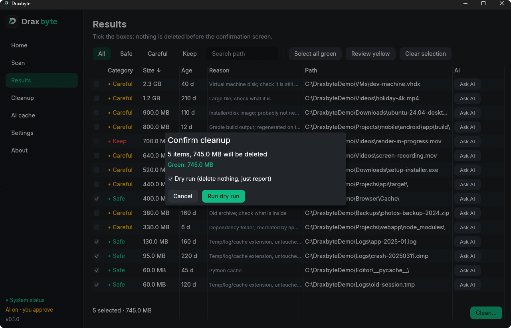
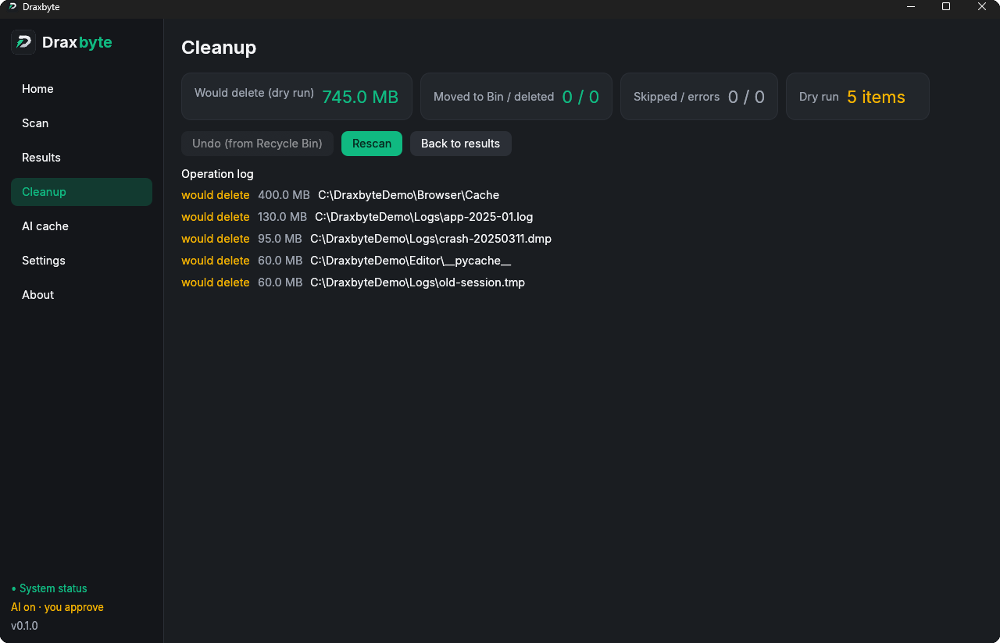
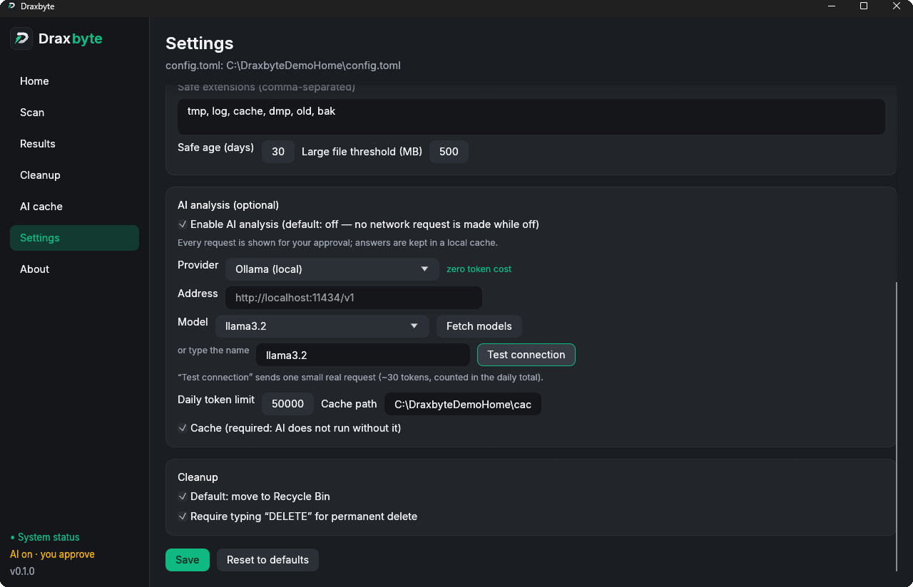
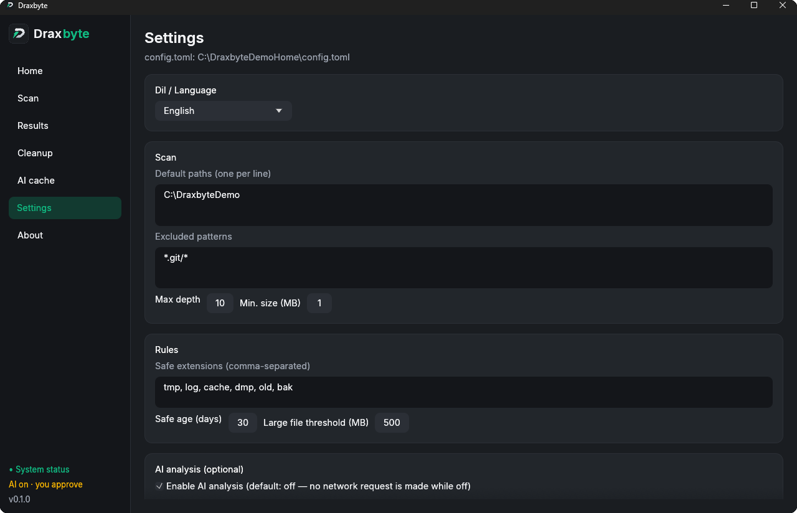
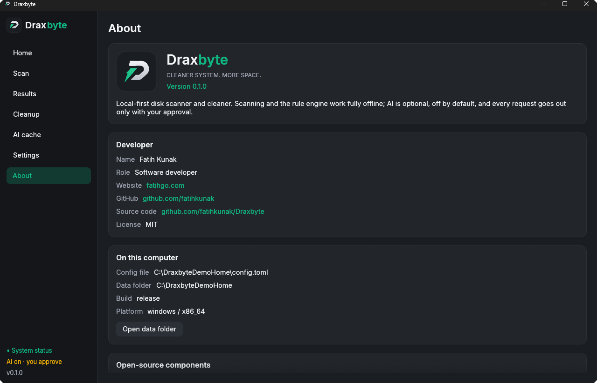

<p align="center">
  
</p>

<h1 align="center">Draxbyte</h1>
<p align="center"><b>Cleaner system. More space.</b></p>
<p align="center">
  Local-first disk scanner and cleaner — Rust + egui, one small binary, works offline.<br>
  <a href="README.md">Türkçe</a> · <b>English</b> · <a href="docs/USAGE.md">User guide</a> · <a href="docs/KULLANIM.md">Kullanım kılavuzu</a> · <a href="https://github.com/fatihkunak/Draxbyte/wiki">Wiki</a>
</p>

<p align="center">
  <a href="LICENSE"></a>
  
  
  <a href="https://github.com/fatihkunak/Draxbyte/releases/latest"></a>
  
</p>

<p align="center">
  <a href="https://github.com/fatihkunak/Draxbyte/releases/latest/download/Draxbyte-Setup.exe"><b>⬇ Download for Windows</b></a> ·
  <a href="https://github.com/fatihkunak/Draxbyte/releases/latest/download/Draxbyte-macos.dmg"><b>⬇ Download for macOS (.dmg)</b></a> ·
  <a href="https://github.com/fatihkunak/Draxbyte/releases/latest/download/draxbyte.exe">portable exe</a> ·
  <a href="https://github.com/fatihkunak/Draxbyte/releases/latest">all files</a>
</p>

<p align="center">
  
</p>

## What is it?

Draxbyte scans your disk, finds **large and useless** files (old logs, caches, `node_modules`, build output,
installer images…), colours them **safe / careful / keep**, and **never deletes anything until you approve**.
Deleted items go to the Recycle Bin by default and can be restored.

- **Local and private.** Scanning and every decision happen on your machine. No telemetry, no account.
- **AI is optional.** It is **off by default**; while it is off, not a single network request is made. If you turn
  it on, every request needs your click, answers are cached locally, and there is a daily token limit.
- **Safety first.** System folders, secrets, locked files and files changed in the last 24 hours are never deleted.
- **Small and self-contained.** About 20 MB, no runtime needed. `Draxbyte-Setup.exe` installs step by step, or use the portable `draxbyte.exe`.
- **Windows and macOS.** Ready-made downloads for both (macOS: one `.dmg` for Intel + Apple Silicon).
- **Two languages.** English and Türkçe, chosen automatically from your system or in Settings.

## Features

- 🔎 **Fast parallel scan** — uses all your cores, cancellable, live counters
- 🧠 **Rule engine, no AI needed** — old logs/dumps, caches, `node_modules`, Gradle/Cargo build output, disk images, big or old archives, virtual disks
- 🚦 **Safe / Careful / Keep** colours with a plain-language reason for every row
- 🛡️ **Safety net** — protected system paths, secrets and links are never touched; every item is re-checked right before deletion
- ♻️ **Reversible** — Recycle Bin by default, one-click undo, dry run, permanent delete only after an extra confirmation
- 📊 **Dashboard** — disk usage ring, largest items, distribution by type, one-click actions
- 🤖 **Optional AI** — 14 providers (Ollama and LM Studio run locally for free), models fetched automatically, cached answers, daily token limit, every request approved by you
- ⌨️ **CLI** — `draxbyte scan` / `draxbyte clean` for scripts and servers (dry run by default)
- 🗑️ **Programs** — installed programs with size and last use; remove any of them with **the vendor's uninstaller plus its leftovers** (AppData, registry, services, tasks), or **by force** when there is no uninstaller or the vendor blocks removal (Edge). The registry is exported first and can be restored
- 🧠 **Memory & Startup** — see what uses memory, close what you pick (with a protected list), switch startup programs off/on; "Free memory" with an honest warning that its effect is temporary
- 💽 **Complete scan** — every internal drive and the system folders (`Windows\Temp`, `Package Cache`, `Windows.old`…) plus the Recycle Bin
- 🍎 **macOS** — `.app` bundles with their `~/Library` files; apps on the sealed system volume (Safari, Mail…) cannot be deleted by anything, so only their caches are cleaned
- 🔓 **Nothing out of reach** — on Windows it asks for administrator rights at start (decline and it still opens; Settings turns it off); a scan lists every path it could not read **with the reason** (access denied / in use) and offers the one-click fix (Full Disk Access on macOS)
- 🗺️ **Disk Map** — what is taking the space? Coloured tiles sized by use (a treemap); click a folder to look inside; read-only
- 👯 **Duplicate Files** — files with exactly the same content (size → first/last 64 KB → full SHA-256); at least one copy of every group always stays; deletion goes to the Recycle Bin
- 🧹 **Full Optimization** — cleanup, duplicates, Docker (part by part), Recycle Bin and memory in one flow: you pick the scope, review a read-only analysis and approve; nothing changes before the approval. `draxbyte optimize`
- 🤖 **AI Advisor** — a chat about the last scan plus a one-click AI report. Add several providers in Settings → AI as a failover chain (moves on at an error, rate limit or timeout and shows who failed and why). It only advises, never deletes; off by default, the summary to be sent is previewed, file contents never leave your PC
- 🧙 **Install and uninstall wizard** — `Draxbyte-Setup.exe` installs step by step with the same theme and logo (Windows) / opened from the disk image it installs into Applications (macOS); uninstall is a wizard too and removes only its own files
- 🌍 **English and Türkçe** UI, automatic or your choice
- 📦 **One ~16 MB exe**, offline, no telemetry, MIT licensed

## How it works

1. **Scan** — the app walks your folders in parallel and asks the rule engine what each item is. Nothing is changed.
2. **Review** — you see every candidate with size, age and the reason. Tick what you want gone.
3. **Clean** — a confirmation shows the exact total. Items go to the Recycle Bin (or are only reported in a dry run). A report lists what happened to each one, and you can undo.

## Screenshots

| | |
|---|---|
|  |  |
| **Results** — colour-coded, sortable list | **Confirm** — summary, dry run, Recycle Bin / permanent |
|  |  |
| **Cleanup report** — what happened to each item, undo | **AI settings** — many providers, models fetched automatically |

> Screenshots were taken with a throw-away demo folder; they contain no personal files.

<details>
<summary><b>More screenshots</b></summary>

| | |
|---|---|
|  |  |
| **Settings** — language, scan, rules | **About** — version, developer, licences |

</details>

## Getting started

### Download (always the latest release)

| Platform | Download |
|---|---|
| **Windows** (install wizard) | [`Draxbyte-Setup.exe`](https://github.com/fatihkunak/Draxbyte/releases/latest/download/Draxbyte-Setup.exe) |
| **Windows** (portable, no install) | [`draxbyte.exe`](https://github.com/fatihkunak/Draxbyte/releases/latest/download/draxbyte.exe) |
| **macOS** (Intel + Apple Silicon) | [`Draxbyte-macos.dmg`](https://github.com/fatihkunak/Draxbyte/releases/latest/download/Draxbyte-macos.dmg) |

These links always point to the [latest release](https://github.com/fatihkunak/Draxbyte/releases/latest); verify with `SHA256SUMS.txt` on the same page.
See [Signing](#signing-and-smartscreen) if Windows shows a warning, and [Platforms](#platforms) for the first launch on macOS.

### Build from source

Requirements: [Rust](https://rustup.rs) (stable) and the Visual Studio C++ Build Tools.

```powershell
git clone https://github.com/fatihkunak/Draxbyte.git
cd Draxbyte
powershell -File scripts\install.ps1
```

`install.ps1` builds a release binary, copies it to `%LOCALAPPDATA%\Programs\Draxbyte` and creates **Desktop and
Start Menu shortcuts**. Run it again to update. To just try it: `cargo run --release`.

### First run (1 minute)

1. Press **Quick scan** (default: your home folder + the temp folder).
2. On **Results**, press **Select all green** to tick the safe items.
3. **Clean…** → check the summary → try **Dry run** first → then **Move to Bin**.
4. Changed your mind? **Cleanup → Undo**.

Full walkthrough: **[docs/USAGE.md](docs/USAGE.md)**.

## What do the colours mean?

| Colour | Meaning | Examples |
|---|---|---|
| 🟢 **Safe** | Deleting breaks nothing | Old `.log/.tmp/.dmp`, cache folders, `__pycache__` |
| 🟡 **Careful** | Deletable, but take a look | `node_modules`, Gradle/Cargo build output, disk images (`.iso`), big/old archives, virtual disks |
| 🔴 **Keep** | Cannot be selected or deleted | System files, installed-app files, big files changed in the last 24 h |

Folders such as `node_modules`, `build`, `target` are counted as **one item**, so thousands of files do not flood the list.

## Safety

- Never touched: the Windows folder, Program Files, `/usr` `/etc` and similar, `~/.ssh` `~/.gnupg` `~/.aws`,
  filesystem roots, your home folder itself, and Draxbyte's own data.
- Symlinks and junctions are not followed and not deleted.
- **Right before deleting, every item is checked again:** does it still exist, is it not a link, is another program
  using it (a lock test on Windows), did it change since the scan? If any check fails the item is skipped and the report says why.
- Red items cannot be selected in the UI and the code refuses them too (two layers).
- Recycle Bin by default; **Delete permanently** needs an extra confirmation (you type `DELETE`).

## AI (optional)

Settings → **AI analysis**. Pick a provider, enter its key, press **Fetch models** to list the models the provider
really offers (costs no tokens), choose one, then **Test connection**.

**AI Advisor:** a chat and a one-click "AI report" in the left menu. It only advises, never deletes. In Settings → AI you can
order several providers as a **failover chain**: every request starts with the primary and moves to the next on a network
error, timeout, rate limit (429), bad key (401), server error (5xx) or unreadable answer; the answer shows who failed and why.
In a chain each provider only gets its own key (`DRAXBYTE_API_KEY_<PROVIDER>`, e.g. `DRAXBYTE_API_KEY_OPENAI`); the shared
`DRAXBYTE_API_KEY` is not used there. First use asks for consent, the summary to be sent is previewed, file contents never
leave your PC, and the chat lives in memory only.

Providers: **Ollama** and **LM Studio** (local, no key, zero cost) · Google Gemini · Groq · OpenRouter · NVIDIA NIM ·
Mistral · Anthropic · OpenAI · Kimi · xAI · EVREN · Alibaba · any OpenAI-compatible custom URL.

| Guard | Behaviour |
|---|---|
| Off by default | With `ai.enabled = false` not even a client is created |
| Rules first | Scanning and classification are local; AI only runs when you ask “what is this?” |
| One approval per request | “Ask AI” shows the **exact text** that will be sent (no file contents, only path + metadata) |
| Cache first | Key = path + size + modified time; the same file is never sent twice |
| Cache is mandatory | AI does not run with the cache off |
| Daily limit | Tokens are counted per day; clearing the cache does not reset the counter |

> **Honest note:** model listing and chat were tested against a **real local OpenAI-compatible server**; the other
> providers are covered by unit tests (request shape, auth header, response parsing) but were not tried with live
> accounts. Keys are stored as plain text in `config.toml`; prefer the `DRAXBYTE_API_KEY` environment variable.

## Command line

```powershell
draxbyte scan [PATHS...] [--limit N] [--save]        # list (changes nothing)
draxbyte clean [PATHS...] [--yellow]                  # DRY RUN (default)
draxbyte clean [PATHS...] [--yellow] --apply          # move to the Recycle Bin
draxbyte clean [PATHS...] --apply --permanent         # delete for good (asks you to type DELETE)
draxbyte recycle [--empty]                             # Recycle Bin size / empty it
draxbyte apps [--unused-days N] [--store] [--hidden]   # installed programs, size, last use
draxbyte uninstall "Name"                              # show what it would touch (dry run)
draxbyte uninstall "Name" --apply [--force] [--silent] # uninstaller + leftovers; --force skips the uninstaller
draxbyte memory [--trim]                               # memory use (Windows: --trim frees idle memory, temporarily)
draxbyte startup [--disable NAME | --enable NAME]      # what starts with Windows
draxbyte dupes [PATHS...] [--min-size-mb N]            # duplicate files (dry run)
draxbyte dupes [PATHS...] --apply [--keep oldest|newest|shortest] [--permanent]   # remove the extra copies
draxbyte map [PATH] [--depth N] [--limit N]            # text disk map: the biggest folders/files
draxbyte optimize [--apply] [--docker-parts ...] [--docker-compact]  # analyse, then clean up (dry run unless --apply); --docker-parts build,dangling,networks,stopped,images,volumes; --docker-compact shrinks the Docker disk (Windows)
```

Without arguments the GUI opens. `DRAXBYTE_HOME=<folder>` moves the config/data folder (portable use).
Language: `[ui] language = "auto" | "tr" | "en"` in the config, or Settings → Dil / Language.

## Config

`~/.draxbyte/config.toml` (also editable in Settings):

```toml
[ui]
language = "auto"         # auto | tr | en

[scan]
default_paths = ["~"]
max_depth = 10
min_size_mb = 1
exclude_patterns = ["*.git/*", "node_modules/*"]

[rules]
safe_extensions = ["tmp", "log", "cache", "dmp", "old", "bak"]
safe_age_days = 30
large_file_mb = 500

[ai]
enabled = false
provider = "openai"
model = "gpt-4o-mini"
base_url = ""             # only for custom / local / Alibaba
daily_token_limit = 50000
cache_enabled = true
cache_path = "~/.draxbyte/cache.db"
# [ai.api_keys]
# groq = "..."

[cleanup]
use_trash = true
confirm_permanent_delete = true
```

## Signing and SmartScreen

Release binaries are signed with a **self-signed code-signing certificate** (“Fatih Kunak”). That proves the file
was not modified after signing, but Windows does not trust a self-signed publisher, so SmartScreen may still show
“Windows protected your PC” — choose **More info → Run anyway**. You can verify the download against the
`SHA256` value in the release notes. The public certificate is in [`assets/draxbyte-codesign.cer`](assets/draxbyte-codesign.cer).
If you would rather not trust a binary, build it from source (see above).

## Platforms

Developed on **Windows 11**.

**macOS:** download `Draxbyte-*-macos.dmg` (Intel + Apple Silicon) from [Releases](https://github.com/fatihkunak/Draxbyte/releases/latest).
GitHub's macOS runner runs the unit tests and a scan against a fake Mac home (`scripts/macos/smoke.sh`): `.app` bundles,
iCloud/CloudStorage, the Photos library and Mail/Messages/Keychains are never offered. The GUI has not yet been tried by
hand on a real Mac. The app is **not signed or notarized by Apple**: on first launch right-click → Open (or
`xattr -dr com.apple.quarantine /Applications/Draxbyte.app`). There is no programmatic undo on macOS (restore from the
Trash by hand) and in-app update is Windows-only. Build it yourself with `bash scripts/macos/build-dmg.sh`.

**Linux:** platform-aware code, but not built or tried.

## Development

```powershell
cargo test                                          # unit tests
cargo test --test trash_roundtrip -- --ignored      # real Recycle Bin round trip (opt-in)
$env:DRAXBYTE_LIVE_URL="http://localhost:8080/v1"; cargo test --test live_provider -- --ignored --nocapture
cargo build --release                               # target\release\draxbyte.exe
powershell -File scripts\release.ps1                # build + sign + zip + checksums
python scripts\make_icon.py "<design.png>"          # regenerate the icon
```

```
src/core/    scanner, rule engine, safety, cleaner         (the product)
src/ai/      providers, client, cache, prompt              (optional)
src/i18n.rs  Turkish / English text
src/ui/      egui screens        src/app.rs  state + background jobs
docs/wiki/   architecture wiki (Obsidian-compatible)   docs/USAGE.md  user guide
```

Design decisions and why: [DECISIONS.md](DECISIONS.md) · module map: [docs/wiki/Index.md](docs/wiki/Index.md).

## Roadmap

Ideas, not promises: trusted code signing (SignPath), more cleanup rules (browser/package-manager/game-launcher caches), Linux and macOS testing, a scheduled "monthly scan" reminder, more UI languages. Have an idea? Open an [issue](https://github.com/fatihkunak/Draxbyte/issues).

## Contributing and support

Pull requests are welcome — read [CONTRIBUTING.md](CONTRIBUTING.md) first. Security issues: see [SECURITY.md](SECURITY.md). Release history: [CHANGELOG.md](CHANGELOG.md). Documentation also lives in the [Wiki](https://github.com/fatihkunak/Draxbyte/wiki).

## License

[MIT](LICENSE) © 2026 Fatih Kunak. Typeface **Inter** © The Inter Project Authors,
[SIL Open Font License 1.1](assets/fonts/Inter-LICENSE.txt).

## Developer

**Fatih Kunak** · [fatihgo.com](https://fatihgo.com) · [github.com/fatihkunak](https://github.com/fatihkunak)

Bug reports and suggestions: [Issues](https://github.com/fatihkunak/Draxbyte/issues).
