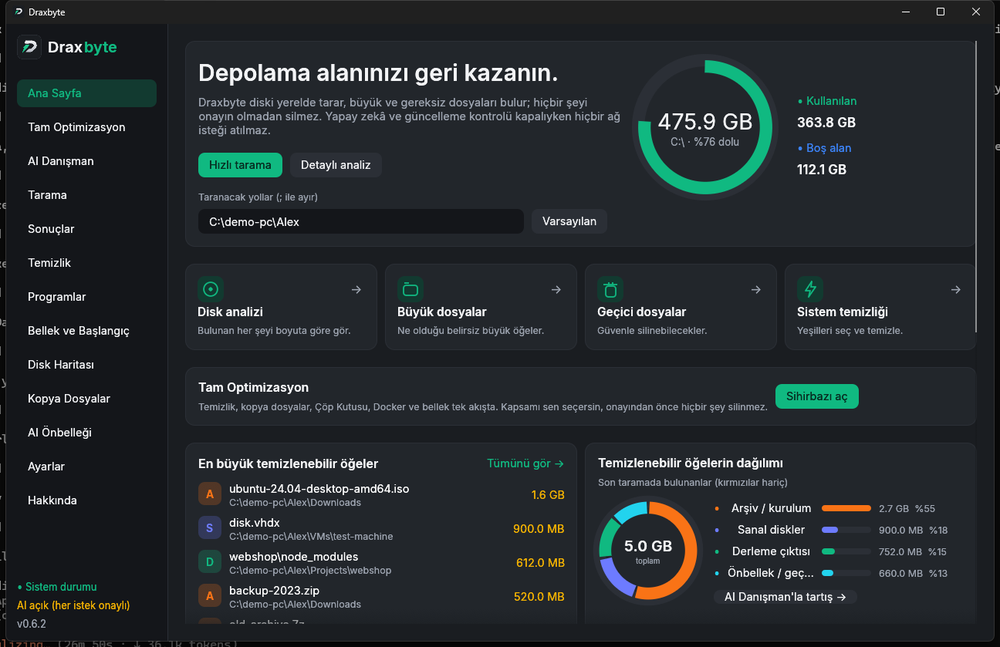
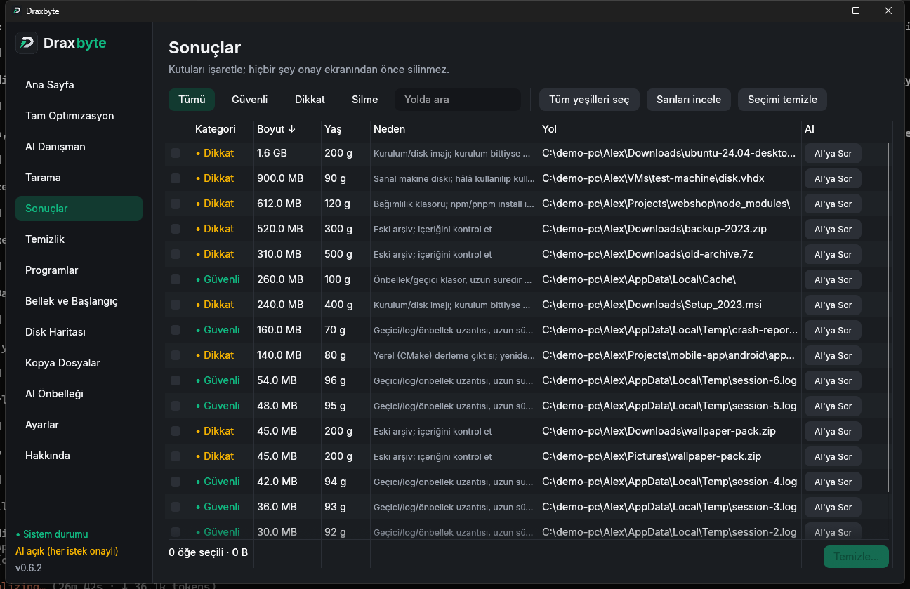
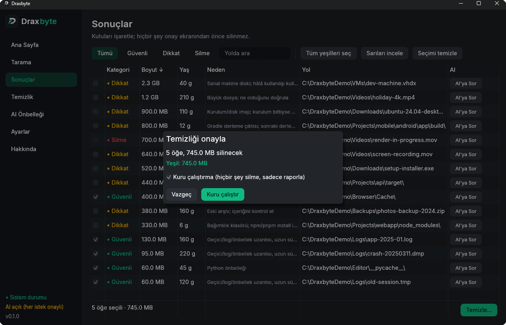
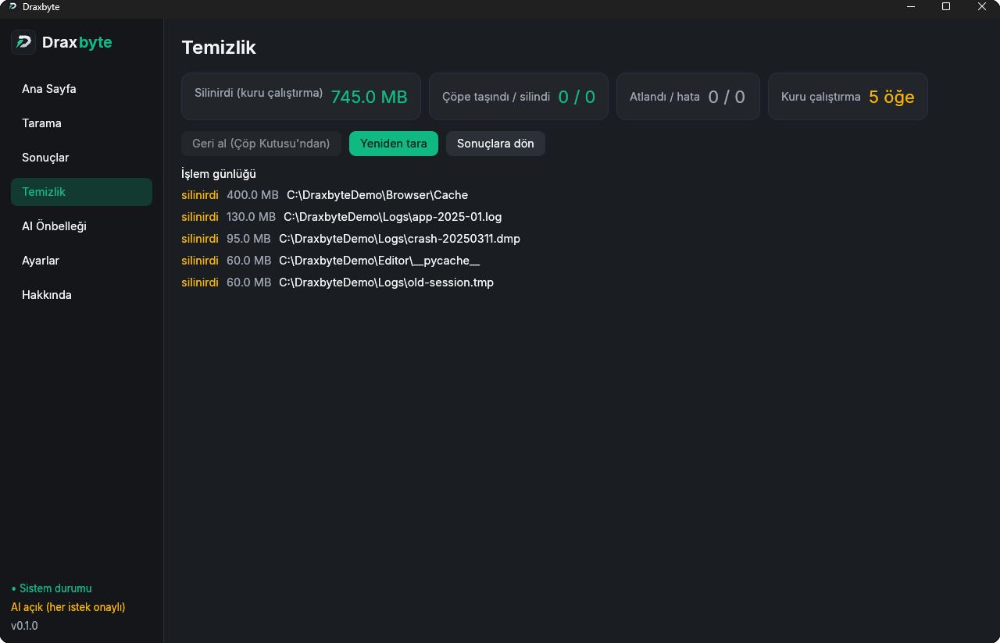
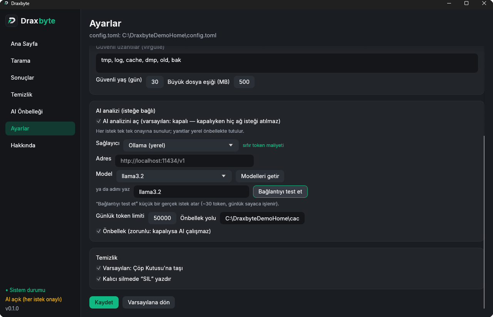
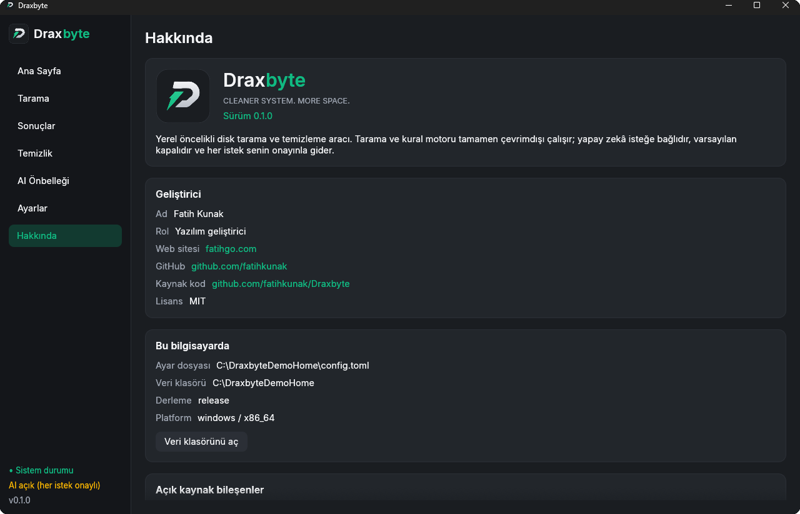

<p align="center">
  
</p>

<h1 align="center">Draxbyte</h1>
<p align="center"><b>Cleaner system. More space.</b></p>
<p align="center">
  Yerel öncelikli disk tarama ve temizleme aracı — Rust + egui, tek dosya, çevrimdışı çalışır.<br>
  <i>Local-first disk scanner and cleaner. One small binary, works offline, never deletes anything without your approval.</i>
</p>

<p align="center">
  <b>Türkçe</b> · <a href="README.en.md">English</a> · <a href="docs/KULLANIM.md">Kullanım kılavuzu</a> · <a href="docs/USAGE.md">User guide</a> · <a href="https://github.com/fatihkunak/Draxbyte/wiki">Wiki</a>
</p>

<p align="center">
  <a href="LICENSE"></a>
  
  
</p>

<p align="center">
  
</p>

## Nedir?

Draxbyte, diskini tarar; **büyük ve gereksiz** dosyaları (eski log'lar, önbellekler, `node_modules`, derleme
çıktıları, kurulum imajları…) bulur, sana **güvenli / dikkat / silme** diye renklendirerek gösterir ve
**sen onaylamadan hiçbir şeyi silmez**. Silinenler varsayılan olarak Çöp Kutusu'na gider ve geri alınabilir.

- **Yerel ve gizli.** Tarama ve karar verme tamamen kendi bilgisayarında olur. Telemetri yok, hesap yok.
- **Yapay zekâ isteğe bağlı.** Varsayılan **kapalı**; kapalıyken tek bir ağ isteği bile atılmaz. Açarsan her
  istek senin onayınla gider, yanıtlar yerelde önbelleğe alınır ve günlük token limiti vardır.
- **Güvenlik önce.** Sistem klasörleri, gizli anahtarlar, kilitli ve son 24 saatte değişmiş dosyalar asla silinmez.
- **Tek küçük dosya.** `draxbyte.exe` ~16 MB, kurulum ya da çalışma zamanı gerekmez.
- **İki dil.** Türkçe ve English; sistem diline göre otomatik, Ayarlar → *Dil / Language*'dan değiştirilebilir.

## Özellikler

- 🔎 **Hızlı paralel tarama** — tüm çekirdekleri kullanır, iptal edilebilir, canlı sayaçlar
- 🧠 **AI gerektirmeyen kural motoru** — eski log/dump, önbellek, `node_modules`, Gradle/Cargo derleme çıktısı, disk imajları, büyük/eski arşivler, sanal diskler
- 🚦 **Güvenli / Dikkat / Silme** renkleri ve her satır için anlaşılır gerekçe
- 🛡️ **Güvenlik ağı** — korumalı sistem yolları, gizli anahtarlar ve bağlar asla silinmez; her öğe silmeden hemen önce yeniden kontrol edilir
- ♻️ **Geri alınabilir** — varsayılan Çöp Kutusu, tek tıkla geri alma, kuru çalıştırma, kalıcı silme yalnızca ek onayla
- 📊 **Gösterge paneli** — disk doluluk halkası, en büyük öğeler, türe göre dağılım, tek tıkla eylemler
- 🤖 **İsteğe bağlı AI** — 14 sağlayıcı (Ollama ve LM Studio yerelde ücretsiz), modeller otomatik getirilir, önbellekli yanıtlar, günlük token limiti, her istek senin onayınla
- ⌨️ **Komut satırı** — betikler ve sunucular için `draxbyte scan` / `draxbyte clean` (varsayılan kuru çalıştırma)
- 🗑️ **Programlar** — kurulu programları boyut ve son kullanımla gör; istediğini **üreticinin kaldırıcısı + artıkları** (AppData, kayıt defteri, servis, görev) ile tamamen kaldır; kaldırıcı yoksa ya da üretici engelliyorsa (Edge) **zorla kaldır**. Kayıt defteri önce yedeklenir, geri yüklenebilir
- 🧠 **Bellek ve Başlangıç** — belleği kimin yediğini gör, seçtiğini kapat (korumalı liste), başlangıçta açılanları kapat/aç; "Belleği boşalt" dürüst bir uyarıyla (etkisi geçicidir)
- 💽 **Eksiksiz tarama** — her dahili sürücü ve sistem klasörleri (`Windows\Temp`, `Package Cache`, `Windows.old`…) + Geri Dönüşüm Kutusu
- 🗺️ **Disk Haritası** — alan neyin altında? Boyutla orantılı renkli kutular (treemap), tıklayınca klasörün içine girersin; salt okunur
- 👯 **Kopya Dosyalar** — birebir aynı içerikli dosyalar (boyut → ilk/son 64 KB → tam SHA-256); her gruptan en az bir kopya her zaman kalır, silme Çöp Kutusu'na
- 🧙 **Kurulum ve kaldırma sihirbazı** — `Draxbyte-Setup.exe` aynı tema ve logoyla adım adım kurar (Windows) / DMG'den açılınca Applications'a kurar (macOS); kaldırma da sihirbazdır ve yalnızca kendi dosyalarını siler
- 🌍 **Türkçe ve English** arayüz, otomatik ya da seçimine göre
- 📦 **Tek ~16 MB exe**, çevrimdışı, telemetri yok, MIT lisanslı

## Nasıl çalışır?

1. **Tara** — uygulama klasörlerini paralel gezer, kural motoruna her öğenin ne olduğunu sorar. Hiçbir şey değişmez.
2. **İncele** — her adayı boyutu, yaşı ve gerekçesiyle görürsün. Gitmesini istediklerini işaretle.
3. **Temizle** — onay ekranı tam toplamı gösterir. Öğeler Çöp Kutusu'na taşınır (kuru çalıştırmada yalnızca raporlanır). Rapor her öğeye ne olduğunu listeler; geri alabilirsin.

## Ekran görüntüleri

| | |
|---|---|
|  |  |
| **Sonuçlar** — renk kodlu, sıralanabilir, kutulu liste | **Onay** — özet, kuru çalıştırma, Çöp Kutusu / kalıcı silme |
|  |  |
| **Temizlik raporu** — her öğe için ne olduğu, geri alma | **AI ayarları** — çoklu sağlayıcı, modelleri otomatik getirme |

> Görüntüler örnek (demo) klasörleriyle alındı; kişisel dosya içermez.

<details>
<summary><b>Daha fazla ekran görüntüsü / English screenshots</b></summary>

| | |
|---|---|
|  |  |
| **Hakkında** — sürüm, geliştirici, lisanslar | **English UI** — [README.en.md](README.en.md) |
|  |  |
| **Results** (English) | **Settings → Dil / Language** |

</details>

## Başlarken

### Hazır exe indir (Windows)

[En son sürümden](https://github.com/fatihkunak/Draxbyte/releases/latest) `draxbyte.exe` dosyasını indirip çalıştır.
Windows uyarı gösterirse aşağıdaki *İmza ve SmartScreen* bölümüne bak.

### Kaynaktan derle (Windows)

Gereksinim: [Rust](https://rustup.rs) (stable) ve Visual Studio Build Tools (C++).

```powershell
git clone https://github.com/fatihkunak/Draxbyte.git
cd Draxbyte
powershell -File scripts\install.ps1
```

`install.ps1` release derlemesi yapar, exe'yi `%LOCALAPPDATA%\Programs\Draxbyte` klasörüne kopyalar ve
**masaüstü + Başlat menüsü kısayolu** oluşturur. Güncellemek için aynı komutu tekrar çalıştır.

Yalnızca denemek istersen: `cargo run --release`.

### İlk kullanım (1 dakika)

1. **Hızlı tarama**'ya bas (varsayılan: ev klasörün + geçici klasör).
2. **Sonuçlar**'da listeye bak; **Tüm yeşilleri seç** ile güvenli olanları işaretle.
3. **Temizle…** → özeti kontrol et → önce **Kuru çalıştırma** ile ne olacağını gör → sonra **Çöpe taşı**.
4. Yanlış bir şey olduysa **Temizlik → Geri al**.

Ayrıntılı anlatım: **[docs/KULLANIM.md](docs/KULLANIM.md)**.

## Renkler ne demek?

| Renk | Anlamı | Örnekler |
|---|---|---|
| 🟢 **Güvenli** | Silinince bir şey bozulmaz | Eski `.log/.tmp/.dmp`, önbellek klasörleri, `__pycache__` |
| 🟡 **Dikkat** | Silinebilir ama bir göz at | `node_modules`, Gradle/Cargo derleme çıktısı, disk imajları (`.iso`), büyük/eski arşivler, sanal diskler |
| 🔴 **Silme** | Seçilemez, silinmez | Sistem dosyaları, kurulu uygulama dosyaları, son 24 saatte değişen büyük dosyalar |

`node_modules`, `build`, `target` gibi klasörler **tek öğe** olarak toplanır; içindeki binlerce dosya listeyi boğmaz.

## Güvenlik

- Hiçbir zaman silinmeyenler: Windows klasörü, Program Files, `/usr` `/etc` gibi sistem ağaçları, `~/.ssh`
  `~/.gnupg` `~/.aws`, dosya sistemi kökü, ev klasörünün kendisi, Draxbyte'ın kendi verisi.
- Sembolik bağlar / junction'lar takip edilmez ve silinmez.
- **Silmeden hemen önce her öğe yeniden kontrol edilir:** hâlâ var mı, link değil mi, başka program kullanıyor mu
  (Windows'ta kilit denemesi), taramadan sonra değişti mi? Biri tutmazsa o öğe atlanır ve raporda nedeni yazar.
- Kırmızı öğeler arayüzde seçilemez; kod da ayrıca reddeder (iki katman).
- Varsayılan Çöp Kutusu; **Kalıcı sil** ayrı onay ister (`SIL` yazdırır).

## Yapay zekâ (isteğe bağlı)

Ayarlar → **AI analizi**. Bir sağlayıcı seç, anahtarını gir, **Modelleri getir** ile sağlayıcının gerçek model
listesini çek (token harcamaz), birini seç, **Bağlantıyı test et**.

Desteklenen sağlayıcılar: **Ollama** ve **LM Studio** (yerel, anahtarsız, sıfır maliyet) · Google Gemini · Groq ·
OpenRouter · NVIDIA NIM · Mistral · Anthropic · OpenAI · Kimi · xAI · EVREN · Alibaba · herhangi bir OpenAI uyumlu
özel adres.

| Koruma | Davranış |
|---|---|
| Varsayılan kapalı | `ai.enabled = false` iken istemci bile oluşturulmaz |
| Önce kurallar | Tarama ve sınıflandırma yereldir; AI yalnızca "bu nedir?" diye sorarsan devreye girer |
| Tek tek onay | "AI'ya Sor" gönderilecek **tam metni** gösterir (dosya içeriği gönderilmez, yalnız yol + meta veri) |
| Önbellek önce | Anahtar = yol + boyut + değişme zamanı. Aynı dosya için ikinci istek atılmaz |
| Önbellek zorunlu | Kapalıysa AI çalışmaz |
| Günlük limit | Token sayacı günlüktür; "önbelleği temizle" sayacı sıfırlamaz |

> **Dürüst not:** Model listesi ve sohbet isteği bir **yerel OpenAI uyumlu sunucuyla gerçekten denendi**;
> diğer sağlayıcılar birim testleriyle (istek biçimi, kimlik başlığı, yanıt çözümü) doğrulandı ama canlı hesapla
> denenmedi. Anahtarlar `config.toml` içinde düz metin saklanır; tercihen `DRAXBYTE_API_KEY` ortam
> değişkenini kullan.

## Komut satırı

```powershell
draxbyte scan [YOLLAR...] [--limit N] [--save]        # listele (hiçbir şeyi değiştirmez)
draxbyte clean [YOLLAR...] [--yellow]                  # KURU ÇALIŞTIRMA (varsayılan)
draxbyte clean [YOLLAR...] [--yellow] --apply          # Çöp Kutusu'na taşı
draxbyte clean [YOLLAR...] --apply --permanent         # kalıcı sil ("SIL" yazdırır)
draxbyte recycle [--empty]                             # Geri Dönüşüm Kutusu boyutu / boşalt
draxbyte apps [--unused-days N] [--store] [--hidden]   # kurulu programlar, boyut, son kullanım
draxbyte uninstall "Ad"                                # neye dokunacağını göster (kuru çalıştırma)
draxbyte uninstall "Ad" --apply [--force] [--silent]   # kaldırıcı + artıklar; --force: kaldırıcıyı atla
draxbyte memory [--trim]                               # bellek kullanımı (Windows: --trim geçici boşaltır)
draxbyte startup [--disable AD | --enable AD]          # Windows'la açılanlar
draxbyte dupes [YOLLAR...] [--min-size-mb N]           # kopya dosyalar (kuru çalıştırma)
draxbyte dupes [YOLLAR...] --apply [--keep oldest|newest|shortest] [--permanent]   # fazla kopyaları kaldır
draxbyte map [YOL] [--depth N] [--limit N]             # metin disk haritası: en büyük klasörler/dosyalar
```

Argümansız çalıştırırsan arayüz açılır. `DRAXBYTE_HOME=<klasör>` ile ayar/veri klasörünü değiştirebilirsin
(taşınabilir kullanım).

## Ayar dosyası

`~/.draxbyte/config.toml` (Ayarlar ekranından da düzenlenir):

```toml
[scan]
default_paths = ["~"]
max_depth = 10
min_size_mb = 1
exclude_patterns = ["*.git/*", "node_modules/*"]

[rules]
safe_extensions = ["tmp", "log", "cache", "dmp", "old", "bak"]
safe_age_days = 30
large_file_mb = 500

[ui]
language = "auto"         # auto | tr | en

[ai]
enabled = false
provider = "openai"
model = "gpt-4o-mini"
base_url = ""             # yalnızca özel / yerel / Alibaba için
daily_token_limit = 50000
cache_enabled = true
cache_path = "~/.draxbyte/cache.db"
# [ai.api_keys]
# groq = "..."

[cleanup]
use_trash = true
confirm_permanent_delete = true
```

## İmza ve SmartScreen

Sürüm exe'leri **kendinden imzalı** bir kod imzalama sertifikasıyla ("Fatih Kunak") imzalanır. Bu imza dosyanın
imzalandıktan sonra **değiştirilmediğini** kanıtlar; ama Windows kendinden imzalı yayıncıya güvenmediği için
SmartScreen yine de "Windows bilgisayarınızı korudu" diyebilir — **Ek bilgi → Yine de çalıştır** de. İndirdiğin dosyayı
sürüm notundaki `SHA256` değeriyle doğrulayabilirsin. Açık sertifika: [`assets/draxbyte-codesign.cer`](assets/draxbyte-codesign.cer).
Bir ikiliye güvenmek istemezsen kaynaktan derle (yukarıda).

## Platformlar

Geliştirme **Windows 11**'de yapıldı.

**macOS:** [Releases](https://github.com/fatihkunak/Draxbyte/releases/latest)'tan `Draxbyte-*-macos.dmg` (Intel + Apple Silicon).
GitHub'ın macOS makinesinde birim testleri ve sahte bir Mac home'u üzerinde tarama testi (`scripts/macos/smoke.sh`)
çalıştırılır: `.app` paketleri, iCloud/CloudStorage, Fotoğraflar kitaplığı, Mail/Messages/Keychains önerilmez.
Arayüz gerçek bir Mac'te henüz elle denenmedi. Uygulama Apple tarafından **imzalı/noter onaylı değil**: ilk açılışta
sağ tık → Aç (olmazsa `xattr -dr com.apple.quarantine /Applications/Draxbyte.app`). macOS'ta programatik geri alma
yoktur (Çöp Kutusu'ndan elle geri al), uygulama içi güncelleme yalnızca Windows'ta vardır. Kendin üretmek için:
`bash scripts/macos/build-dmg.sh`.

**Linux:** kod platforma duyarlı yazıldı ama derlenip denenmedi.

## Geliştirme

```powershell
cargo test                                          # birim testleri
cargo test --test trash_roundtrip -- --ignored      # gerçek Çöp Kutusu turu (isteğe bağlı)
$env:DRAXBYTE_LIVE_URL="http://localhost:8080/v1"; cargo test --test live_provider -- --ignored --nocapture
cargo build --release                               # target\release\draxbyte.exe
powershell -File scripts\release.ps1                # derle + imzala + sağlama toplamı
python scripts\make_icon.py "<tasarım.png>"         # simgeyi yeniden üretir
```

```
src/core/    tarayıcı, kural motoru, güvenlik, temizleyici   (ürünün kendisi)
src/ai/      sağlayıcılar, istemci, önbellek, prompt         (isteğe bağlı)
src/i18n.rs  Türkçe / English metinler
src/ui/      egui ekranları      src/app.rs  durum + arka plan işleri
docs/wiki/   mimari wiki (Obsidian uyumlu)   docs/KULLANIM.md  kullanım kılavuzu
```

Mimari kararlar ve nedenleri: [DECISIONS.md](DECISIONS.md) · modül haritası: [docs/wiki/Index.md](docs/wiki/Index.md).

## Yol haritası

Fikirler, söz değil: güvenilir kod imzası (SignPath), daha çok temizlik kuralı (tarayıcı/paket yöneticisi/oyun başlatıcı önbellekleri), Linux ve macOS testi, aylık tarama hatırlatıcısı, daha fazla arayüz dili. Fikrin mi var? [Issue](https://github.com/fatihkunak/Draxbyte/issues) aç.

## Katkı ve destek

Pull request'ler hoş karşılanır — önce [CONTRIBUTING.md](CONTRIBUTING.md) dosyasını oku. Güvenlik sorunları: [SECURITY.md](SECURITY.md). Sürüm geçmişi: [CHANGELOG.md](CHANGELOG.md). Belgeler [Wiki](https://github.com/fatihkunak/Draxbyte/wiki)'de de var.

## Lisans

[MIT](LICENSE) © 2026 Fatih Kunak. Yazı tipi **Inter** © The Inter Project Authors,
[SIL Open Font License 1.1](assets/fonts/Inter-LICENSE.txt).

## Geliştirici

**Fatih Kunak** · [fatihgo.com](https://fatihgo.com) · [github.com/fatihkunak](https://github.com/fatihkunak)

Hata bildirimi ve öneriler için [Issues](https://github.com/fatihkunak/Draxbyte/issues).
